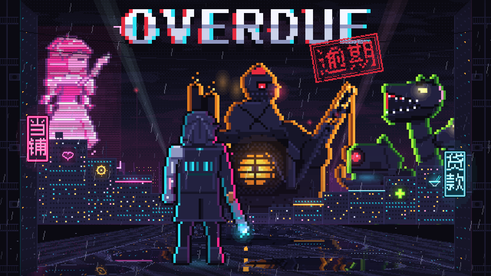

# OVERDUE 逾期

Top-down boss-rush roguelite. Only boss fights: every arena has things you can use against the boss, every weapon plays differently, and every cyberware part replaces one of your moves. Pixel art and audio are generated in code.

Built from the assets of CHROME DEBT (`D:\AI\projects\chrome-debt`, tag `m1-paused`).

## Bosses

| Boss | Arena | Use the arena |
|---|---|---|
| Gearjaw 齿颚 | Rustport scrapyard | crane drop (levers), barrels, ram him into pillars |
| Madame Lux 卢克丝夫人 | Neon Bazaar club | breakers (blackout), projectors (clones), mirrors (reflect her laser) |
| Octohydra 八头蛇 | Undernet flooded server room | conduits electrify the water and cauterise stumps, racks block beams |
| Director Kade 凯德主管 | Skyline rooftop helipad | hack turrets, helicopter downdraft and crash, break searchlights, hit him behind the shield |

Standees: `standee-preview.html`.

## Play

Runs start and end in the hub (据点): weapon racks, a practice cyberware bench, a training dummy and turret, and the exit elevator.

Double-click `play.bat`: it builds a snapshot and serves it at http://127.0.0.1:5180/ without file watching, so edits to the code never restart the game you are playing (run it again to get the latest version). `dev.bat` / `npm run dev` is the hot-reload development server at http://127.0.0.1:5174/; it reloads the page whenever a source file is saved.

WASD move · mouse aim · LMB attack · RMB weapon special · Space dash (legs) · Q arm · E interact · Esc pause.

## Develop

- `npm test` — art build + headless bot fights for every boss and weapon
- `npm run typecheck`
- Dev URL: `/?boss=gearjaw&weapon=arc&cyber=legs_leap,arm_fist&bot&god`
- New bosses: `/?boss=kairo` (校时员·刻洛, memory archive) and `/?boss=fold` (建筑师·折尺, sliding rooms); both are also in the hub simulator. Each run still draws four bosses from the seven available.
- `node tools/cdp.mjs` — headless Edge run with screenshots and console-error check (`tools/cdp-hub.mjs` for the hub)
- `/?cover` renders the cover only (exported to `docs/cover.png`, `docs/cover_1920.png`)

Docs: `docs/GDD.md` (design, Chinese), `docs/BOSS_API.md` (how to add a boss).

Font: Fusion Pixel 12px, SIL OFL 1.1 (`public/fonts/OFL-fusion-pixel.txt`).

## Share a portable release

Run `npm run package` to build and create `releases/OVERDUE-<version>-windows-portable.zip`.
Send that ZIP to friends. On Windows 10/11 they extract the entire folder and double-click
`Start.bat`; Node.js, npm, Python and internet access are not needed to play. The launcher
uses built-in Windows PowerShell and opens the default browser. Keep its window open while
playing, then close it to stop the local server. Edge or Chrome with WebGL is required.

All game and font URLs are relative. The launcher resolves `game/` relative to its own script,
so the extracted folder can be moved or renamed, including to paths with spaces and Chinese
characters. It binds only to `127.0.0.1`, normally port 18746, and reuses an already running
copy of the same build and folder. If that port is occupied, it tries the next 19 ports.
Browser records and settings belong to the browser and address; a fallback port has separate
records. No developer save data, source files, screenshots or development dependencies are
included in the ZIP. Third-party license notices and file hashes are included.

`npm run test:package` checks the extracted ZIP under a relocated Unicode path, its server,
resource hashes, repeated launches and port collisions. Run `npm test` for gameplay checks.
